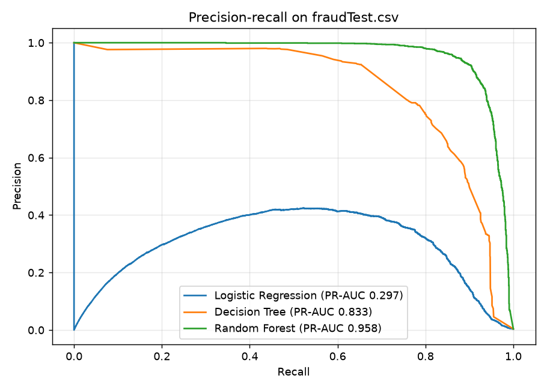

# Credit Card Fraud Detection

Classifies credit card transactions as fraudulent or legitimate, comparing
**Logistic Regression**, a **Decision Tree** and a **Random Forest**.

## Dataset

[Credit Card Transactions Fraud Detection Dataset](https://www.kaggle.com/datasets/kartik2112/fraud-detection)
(Kaggle). The CSVs are too large for GitHub, so download `fraudTrain.csv` and
`fraudTest.csv` into `data/` next to the script (or set `FRAUD_DATA_DIR`).

- Train: 1,296,675 transactions, 0.58% fraud
- Test: 555,719 transactions, 0.39% fraud (later in time than the training data)

## Run

```bash
pip install pandas scikit-learn matplotlib
python train_models.py   # ~8 minutes on 4 CPUs
```

## Approach

- **Features:** amount, hour / day of week / night flag, cardholder age, city population,
  customer-to-merchant distance, merchant category, plus per-card history built only from
  that card's *earlier* transactions: time since the last transaction, amount vs. the card's
  usual amount (overall and per category), and number of transactions and spend in the last 24h.
- **Class imbalance:** balanced class weights, and models are judged on precision, recall,
  F1 and PR-AUC rather than accuracy (every model scores >99% accuracy).
- **Threshold:** each model's decision threshold is tuned for F1 on the last 20% of the
  training period; the test set is never used for tuning.

## Results (test set)

| Model | Precision | Recall | F1 | PR-AUC | ROC-AUC | Frauds caught | False alarms |
|---|---|---|---|---|---|---|---|
| Logistic Regression | 0.402 | 0.658 | 0.499 | 0.297 | 0.978 | 1,412 / 2,145 | 2,103 |
| Decision Tree | 0.791 | 0.778 | 0.784 | 0.833 | 0.975 | 1,668 / 2,145 | 441 |
| **Random Forest** | **0.938** | **0.883** | **0.910** | **0.958** | **0.996** | 1,895 / 2,145 | 125 |



The Random Forest is clearly best. Logistic Regression struggles because fraud here depends
on feature combinations (e.g. large amounts late at night in certain categories) that a
linear model can't capture without hand-built interactions. The most important features were
24h spend, transaction amount and the night-time flag (`rf_feature_importance.csv`).

## Files

- `train_models.py` – feature engineering, training and evaluation
- `results.json` – metrics at the tuned threshold and at 0.5
- `results_summary.csv`, `rf_feature_importance.csv`, `pr_curves.png` – outputs
